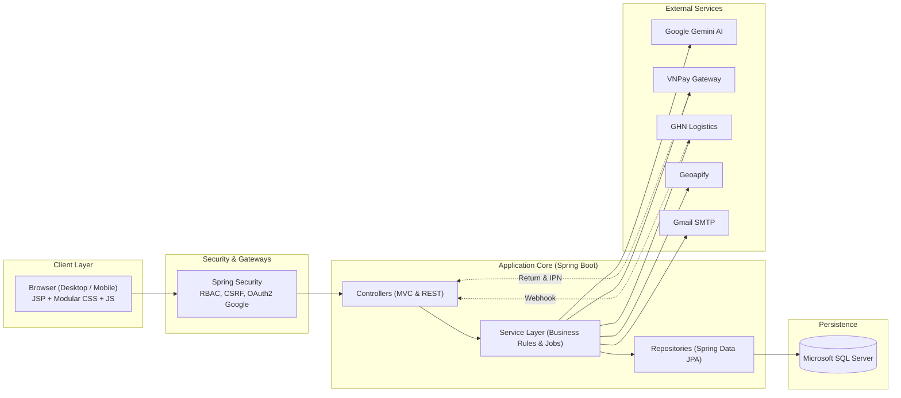

#  PetFood Shop — Smart E-Commerce Platform

[](https://www.oracle.com/java/)
[](https://spring.io/projects/spring-boot)
[](https://www.microsoft.com/sql-server)
[](https://ai.google.dev/)
[](https://vnpay.vn/)
[](https://ghn.vn/)

A full-stack e-commerce web platform for pet food & care products, engineered around a critical real-world challenge: **perishable pet food inventory & shelf-life management**.

The system tracks every product batch by expiry date, guarantees **FEFO (First-Expired, First-Out)** fulfillment at checkout, automatically discounts near-expiry inventory through scheduled **Flash Sales**, and integrates an **AI Shopping Assistant** powered by Google Gemini to guide pet owners with nutritional recommendations from the live catalog.

> **Academic Project:** ISP392 (Software Development Project) — FPT University HCMC.

---

## Highlights & Key Innovations
- **Dynamic Near-Expiry Flash Sales:** Automated clearance campaigns dynamically discount lots based on remaining shelf life (e.g., 40% off for 30–89 days, 70% off for 21–29 days, unsold under 21 days).
- **I Shopping Assistant:** Integrated with Google Gemini API to offer real-time product recommendations grounded strictly in the store's active inventory, with strict guardrails against prompt injection and hallucinated products.
- **Real-World Integrations:**
  - **VNPay Sandbox:** Secure digital payment with HMAC-SHA512 signed transactions and background verification.
  - **Giao Hàng Nhanh (GHN):** Automated waybill generation, live tracking webhooks, and order status sync.
  - **Geoapify Geocoding:** Dynamic shipping fee calculation based on store distance.
- **Complete E-Commerce Lifecycle:** Cart & checkout, COD & VNPay payments, order tracking, returns with photographic evidence inspection, refunds, and loyalty tiers (Bronze / Silver / Gold / Diamond).

---

## 👩‍💻 Author & Contributions

This project was developed by **Group 3 (ISP392)**.

### **Hồ Nhật Vy** ([@HNhatVy](https://github.com/HNhatVy))
**Role:** Frontend Developer & UI/UX Designer
- **UI/UX Architecture:** Designed and built the responsive customer-facing storefront, landing pages, banners, and modern UI components.
- **Core Shopping Experience:** Implemented the interactive **Shopping Cart (`cart.jsp`, `cart.css`)**, **Product Catalog & Filtering (`products.jsp`, `list.jsp`)**, and **Flash Sale Showcases (`flash-sale.jsp`)**.
- **Design System & Styling:** Authored modular, clean CSS styling across the entire storefront (`home.css`, `products.css`, `cart.css`, `flash-sale.css`, `login.css`), ensuring responsive mobile-first behavior and seamless shopping flow.
- **Frontend Integration:** Linked view layers with Spring Boot controllers and dynamic JSP/JSTL templates.
## 🛠️ Tech Stack

| Component | Technology |
|---|---|
| **Backend** | Java 21, Spring Boot 4.1 (Spring MVC, Spring Data JPA / Hibernate, Spring Security, OAuth2 Client, Mail, Validation), Lombok |
| **Frontend** | JSP + JSTL, HTML5, CSS3 (Modular Architecture), Vanilla JavaScript, Spring Form Tags |
| **Database** | Microsoft SQL Server (Transact-SQL) |
| **External APIs** | Google Gemini 1.5 / 2.0 Flash, VNPay Sandbox, GHN API & Webhooks, Geoapify Geocoding, Google OAuth2, Gmail SMTP |
| **Build & Deploy** | Apache Maven (Maven Wrapper included), WAR deployment on Embedded Tomcat |

---

##System Architecture



---

## Role-Based Features

### 1. Customer (Shopper)
- **Catalog & Smart Filter:** Browse items filtered by species (dog/cat), life stage, brand, category, and price range.
- **Product Details:** High-res image gallery, stock availability, nearest expiry indicator, and verified buyer reviews.
- **Shopping Cart & Checkout:** Real-time stock reservation, coupon/membership discounts, distance-based shipping fees, and COD / VNPay choices.
- **Order Management & Tracking:** Live tracking status, order cancellation before fulfillment.
- **Photo/Video Returns:** Submit returns within 3 days with up to 5 proof media files.
- **AI Shopping Assistant:** In-page chat widget for pet food queries and automated catalog recommendations.
- **Security & Authentication:** Sign in with Email / Google OAuth2, secure 6-digit OTP password recovery.

### 👔 2. Staff (Operations)
- **Product & Category Catalog:** Full CRUD with multi-image upload and sanitization.
- **Lot & Inventory Control:** Manage inbound stock batches with expiration dates and lot numbers.
- **Smart Inventory Alerts:** Automated dashboard triggers for low stock levels and approaching expiry dates.
- **Order Fulfillment Workflow:** Confirm → Pack → Dispatch GHN Waybill → Complete.
- **Return & Refund Inspection:** Review return requests, inspect uploaded proof, and approve line-by-line refunds.
- **Review Moderation:** Reply to customer feedback and manage ratings.

### 👑 3. Administrator
- **Executive Analytics Dashboard:** Revenue graphs, order volumes, inventory turnover, and staff KPI metrics.
- **Employee Management:** Create, assign roles, reset credentials, and lock/unlock accounts with immediate session invalidation.
- **Flash Sale Management:** Configure automated discount thresholds, schedules, and campaign rules.
- **Customer Membership Engine:** Automated recalculation of customer tier ranks (Bronze, Silver, Gold, Diamond).

---

## ⚙️ Expiry & Inventory Rules (FEFO)

| Remaining Shelf Life | Allocation Policy | Discount |
|---|---|---|
| **≥ 90 Days** | Standard retail inventory | Regular Price |
| **30 – 89 Days** | Eligible for Flash Sale clearance only | **40% OFF** |
| **21 – 29 Days** | Last-chance clearance only | **70% OFF** |
| **< 21 Days** | Automatically locked out from sale | Not for sale |

*All thresholds and discount percentages are configurable via `application.properties`.*

---

## Getting Started

### Prerequisites
- **JDK 21** or later installed
- **Microsoft SQL Server** running on `localhost:1433`
- Modern Web Browser

### 1. Database Setup
Create database `FoodPetShop` and execute the schema & initial data scripts in SSMS / Azure Data Studio.

### 2. Environment Configuration
Create a `.env` file in the project root directory (same folder as `pom.xml`):

```properties
# Database credentials
DB_PASSWORD=your_sqlserver_sa_password

# (Optional) Integrations - leave blank for mock/fallback mode
petfood.gemini.api-key=your_gemini_api_key
petfood.vnpay.tmn-code=your_vnpay_tmn_code
petfood.vnpay.hash-secret=your_vnpay_hash_secret
petfood.ghn.token=your_ghn_token
petfood.ghn.shop-id=your_ghn_shop_id
petfood.geocoding.geoapify-api-key=your_geoapify_key
spring.mail.username=your_gmail_address
spring.mail.password=your_gmail_app_password


## License & Attribution

This project was developed for educational purposes as part of the ISP392 course at FPT University. All rights reserved by the development team.
